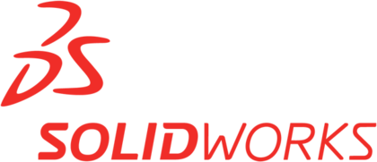
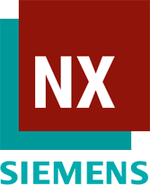
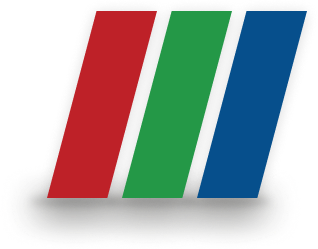
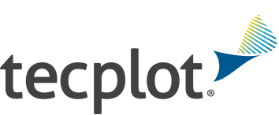
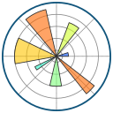

# Engineering begins where the obvious answer ends!

I am an aerospace engineer who enjoys understanding how complex systems work, then figuring out how to make them work better.

My journey has taken me through aerospace, mechanical design, simulation, computation, data analysis and hands-on engineering. These experiences may appear distinct, but they are connected by a common thread: **a desire to understand what lies beneath the surface of a problem, rather than stopping at the obvious answer.**

I enjoy moving between ideas and implementation; designing a component, writing code, analysing data, running a simulation or building physical hardware. The tools change with the problem; my approach remains the same: design, analyse, build, test and look for ways to improve.

Some of my most valuable lessons have come from working with people who approach problems differently from me. I enjoy exchanging ideas, learning from unfamiliar perspectives and discovering approaches I might not have considered on my own. Every project, collaboration and setback offers something to learn from, and I try to carry those lessons into whatever I take on next.

I also enjoy taking ownership of ideas and seeing them through; bringing different pieces together, working through challenges and learning from the gap between what was planned and what actually works.

Aerospace is where my journey began, and it remains the foundation of my engineering perspective. I am drawn to challenging problems, unfamiliar disciplines and opportunities to turn curiosity into something tangible.

---

## WHAT I WORK WITH

The tools change with the problem. The approach does not: understand the system, break the problem down, and keep going until the next question is worth asking.

**Design & Engineering**  
 
 &nbsp;&nbsp;  &nbsp;&nbsp;  &nbsp;&nbsp;  &nbsp;&nbsp; 
  

**Simulation & Analysis**  
 
 &nbsp;&nbsp;  &nbsp;&nbsp;  &nbsp;&nbsp;  &nbsp;&nbsp; 
  

**Programming & Computing**  
 
 &nbsp;&nbsp;  &nbsp;&nbsp;  &nbsp;&nbsp;  &nbsp;&nbsp; 
  

**Data & Workflow**  
 
 &nbsp;&nbsp;  &nbsp;&nbsp;  &nbsp;&nbsp;  &nbsp;&nbsp;  &nbsp;&nbsp; 
  

---

## KEY PROJECTS

| 🚀 [**Project GARUD**](https://github.com/Tanish0224/garud-tvc-rocket) |
| :--- |
| **Thrust-Vector-Controlled Model Rocket**   Represents multidisciplinary systems engineering, mechanical/CAD design, fabrication, and physical hardware integration. |

 

| 🌀 [**Open-Fan Rotor Blade**](https://github.com/Tanish0224/Open-Fan-Rotor) |
| :--- |
| **Swept Open-Fan Rotor Design & Analysis**   Covers 3D CAD modelling and assembly of a swept rotor blade, aerodynamic performance analysis using ANSYS Fluent, and preliminary structural assessment of the blade-root using ANSYS MAPDL. |

 

| ⚡ [**GPU-Accelerated CFD**](https://github.com/Tanish0224/gpu-accelerated-cfd) |
| :--- |
| **High-Performance GPU Compressible Flow Solver**   Represents computational engineering, HPC, GPU programming, CUDA, CuPy, and performance optimization. |

 

| 🚁 [**VTOL UAV Performance Analysis**](https://github.com/Tanish0224/vtol-uav-performance-analysis) |
| :--- |
| **Aerospace Systems Design Investigation**   Represents aerospace systems research, Python, SQL, databases, and data-driven engineering analysis. |

---

## THE PATH SO FAR

*I've learned as much from people, setbacks and unanswered questions as from the things that worked.*

- **STAR — When theory met reality.** My first hands-on experiences with aerospace showed me that understanding how something should work is only the beginning. There is a different kind of learning that happens when you start building, testing and figuring out why things don't go as planned.

- **HAL Nashik — Seeing beyond the individual parts.** Being around aircraft and their subsystems gave me a new appreciation for the people, disciplines and decisions behind a complex machine. I began to see engineering less as isolated components and more as how everything comes together.

- **L&T Defence — Following curiosity further.** What began as a study of VTOL UAVs left me curious about why different aircraft were designed the way they were. I kept digging, researching more than 200 platforms and using Python and SQL to organise the data and explore patterns across their designs.

- **GARUD — Learning alongside others.** Building a thrust-vector-controlled model rocket with a team taught me that good ideas rarely unfold exactly as imagined. Different perspectives, practical constraints and unexpected problems all become part of the journey. Some of the most valuable lessons come from working through them together.

- **IIT Kanpur — Finding new ways to explore.** Since then, my world has expanded across aerospace research, design, analysis, programming, data and computational tools. I enjoy moving between them, learning what each can reveal and finding connections I might have missed otherwise. The more I learn, the more I realise that understanding a problem rarely means reaching the end of the journey, it often means being ready to ask a better question.

## HOW TO REACH ME

**[LinkedIn](https://www.linkedin.com/in/tanish-shetty02/)** &nbsp;&nbsp;•&nbsp;&nbsp; **[Email](mailto:tanish.shetty2002@gmail.com)** &nbsp;&nbsp;•&nbsp;&nbsp; **[GitHub](https://github.com/Tanish0224)**
